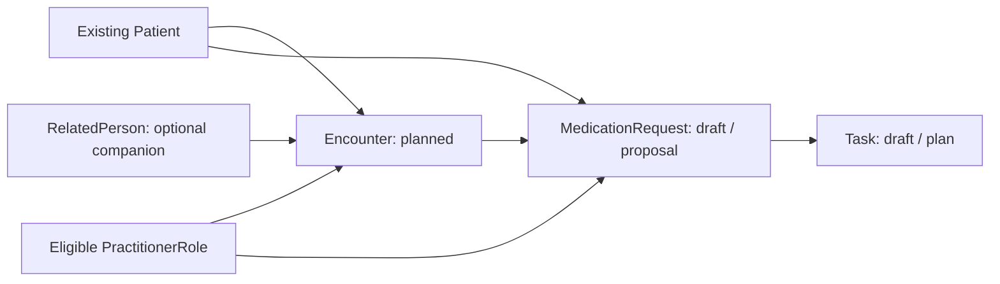

# Headless encounters and prescribing intent

Status: issue #9 model approved; compiler merged in PR #23. Persistence and live acceptance are prepared in the follow-up described in encounter-deployment.md. No encounter resources or prescribing permissions have been deployed.

## Two initial cases

| Case | Patient / companion | Visit | Draft medication concept | Later pharmacy experience |
|---|---|---|---|---|
| Caregiver-assisted infection assessment | Eleanor Bennett / Laura Bennett | North Bay CA clinic, Alex Morgan acute-care role | Amoxicillin | Standard generic fulfillment; authorized caregiver communication |
| Independent adult weight-management assessment | Daniel Wilson | Texas virtual visit, Alex Morgan primary-care role, Austin Metro operational context | Wegovy (semaglutide injection) | Coverage, possible prior authorization and manufacturer savings assessment |

These are invented clinical scenarios, not treatment decisions. Infection diagnosis/testing, allergy history and appropriateness require review; weight-management indication and GLP-1 eligibility are not established by this fixture. No drug strength, dose, schedule, quantity or refill is selected in this slice. Product coding and regimen must be verified before a later authorized prescription. Text-only concepts are deliberately incomplete proposals, not coded dispensable products. No invented RxNorm, diagnosis or lab codes.

Amoxicillin is a reasonable generic test concept because CDC lists penicillin/amoxicillin for confirmed group A strep. This fixture does not claim that a positive test exists. The manufacturer describes commercially insured patient savings for Wegovy, with restrictions; terms and eligibility change. We select it to exercise financial review, without promising a price or savings outcome.

Savings cards/copay assistance, prior authorization, cash pricing and negotiated payer/PBM rebates are distinct. We do not assume Photon exposes or adjudicates rebates. The future financial scenario is synthetic commercial coverage with review required, not verified actual insurance. Do not assign that coverage assumption to Eleanor or infer insurance from her age. No Coverage, claim or approved PA is created now.

## Resource relationships

Each Task.for and MedicationRequest.subject references the patient, never the caregiver. MedicationRequest.encounter, Task.encounter and Task.focus preserve visit/intent context. Encounter.participant can reference the clinician and RelatedPerson. This records participation; it creates no proxy permission, clinical-data grant or message-recipient authorization. Operational market is used only to evaluate existing delivery rules; it is not added to the Patient.

Both visits use the standard ambulatory Encounter.class; virtual mode is represented by the existing logical virtual Location and delivery manifest. Actual visit jurisdiction is explicit scenario input, not inferred from residence or clinician location. Existing configured role/service/site eligibility must pass independently of data access. These synthetic checks do not verify real licensure or availability.

## States and ownership

- Encounter: planned → in-progress → finished; planned/in-progress may cancel. Skip-to-finished and terminal reopening fail locally. The initial fixture persists only planned, if later approved.
- MedicationRequest: draft with intent=proposal; may cancel locally. No transition to active/order or signing/transmission is exposed. Encounter completion never signs a medication automatically.
- Task: draft with intent=plan, linked to the intent and assigned to the role for clinical/financial review. It is not an executed pharmacy order or completed follow-up.

JSON owns initial synthetic definitions and stable identifiers. TypeScript compiles explicitly typed FHIR R4 resources, checks routing and builds identifier-conditional transaction entries using stable urn:uuid links. Local state helpers do not persist changes. Server version checks, runtime actor permissions, reviewed deployment policy and live transition tests are still required before deployment/issue closure. Native server history and deployment evidence must be captured during that implementation; no audit evidence is claimed from a local state helper.

## Current implementation and validation

- code/config/encounters/scenarios.json declares the two cases and fixed authored timestamp.
- code/src/encounters.ts compiles six resources, with no credentials, contacts or network calls.
- `npm run preview:encounters` from code/ prints counts only; no synthetic clinical payload output.
- `npm run validate:encounters` resolves existing patient/caregiver and delivery references using separate enrollment/foundation read scopes, verifies group affiliation and caregiver activity/link, and performs nonpersistent server validation. It neither grants access nor saves resources.
- All 47 local tests pass. All six payloads passed Medplum validation without persistence. Runtime schemas with separate urn references and actual conditional retry behavior still require transaction acceptance in staging; validation does not prove them.

No existing identity has been granted Encounter, MedicationRequest or Task writes. Do not expand foundation or enrollment identities for this milestone. Review the model first, then add a separate exact-identifier scoped encounter identity, authenticated plan/apply/verify, version-controlled transitions and live negative tests within this same #9 branch/PR. Update ADR-002 when those deployment semantics are concrete. Keep #9 open until its full acceptance criteria pass.

## Photon handoff — issue #10

Keep Helix Patient, RelatedPerson, PractitionerRole, Encounter and MedicationRequest identities as the source links. A future adapter must resolve a verified Photon catalog product/regimen, authorized prescriber, external IDs, pharmacy order and idempotency key. A Helix draft proposal alone is never sufficient to transmit.

The intended next-stage tests include Photon embedded/app experience and SMS secure-link experience using an owner-approved personal test phone. Do not put that number into repository configuration or existing synthetic Patient demographics now. Store it privately only after Photon sandbox capabilities, recipient routing and SMS behavior are verified. Caregiver messages must target the authorized caregiver without changing the prescription subject, and require explicit purpose/scope/recipient review. Do not assume native caregiver support in Photon before verifying it.

Photon's documented coverage UI requires patient benefit data, and exposes coverage/cost-related information where supported. Sandbox fidelity, GLP-1 catalog availability, prior-authorization support, real savings behavior, caregiver routing and SMS delivery require verification in #10. No Photon API call, order or SMS occurs under this slice.

## Sources

- [Medplum medication-order modeling](https://www.medplum.com/docs/medications/representing-prescriptions-and-medication-orders); local reference source and FHIR R4 types were read before coding.
- [CDC group A strep guidance](https://www.cdc.gov/group-a-strep/hcp/clinical-guidance/strep-throat.html).
- [Manufacturer Wegovy savings guide](https://www.novomedlink.com/content/dam/novonordisk/novomedlink/new/obesity/product-information/resources/library/wegovy/resource-documents/wegovy-savings-guide.pdf); review current terms in #10, not an eligibility guarantee.
- [Photon integration guide](https://docs.photon.health/docs/integration-guide), [Elements](https://docs.photon.health/docs/elements), [order placement](https://docs.photon.health/docs/place-orders), [documented SMS patient experience](https://blog.photon.health/how-sesame-launched-new-treatment-programs-without-increasing-support-costs-with-photon/).
